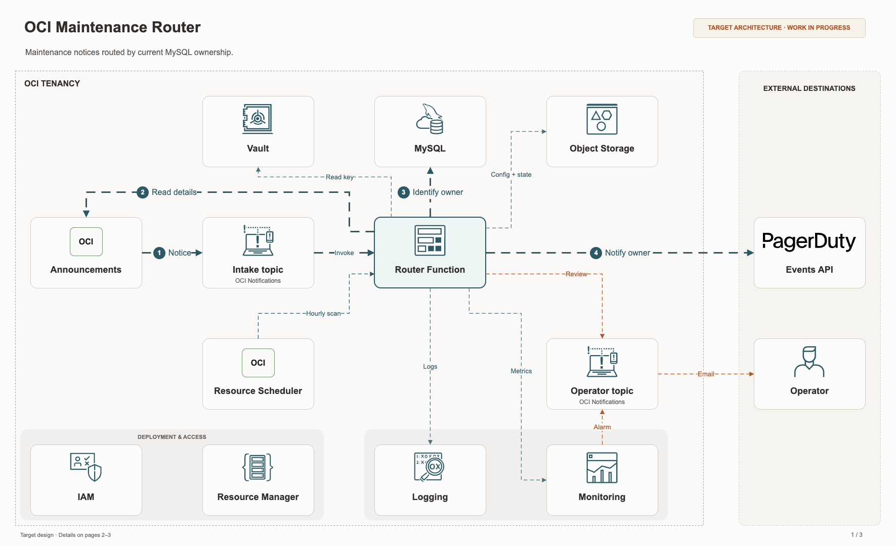

# OCI Maintenance Router

Route OCI maintenance announcements to the right PagerDuty team, with deployment
and configuration through OCI Resource Manager. Support will expand to additional
OCI services over time.

- **Supported today:** HeatWave MySQL scheduled maintenance, routed using defined
  or freeform resource ownership tags.
- **In progress:** Deployment usability improvements and remaining end-to-end
  validation.
- **Planned:** Resource-name matching and additional OCI services.

**Under development — not ready for production use.**

  
   
  <a href="artifacts/oci-maintenance-router-v0.0.3/README.md">v0.0.3 package and checksum</a>

[Step-by-step deployment walkthrough](docs/deployment-walkthrough.md) — deploy in TEST and see the PagerDuty alert.

[MIT License](LICENSE). An independent community solution integrating OCI and
PagerDuty. It is not developed, maintained, sponsored, or supported by Oracle.
