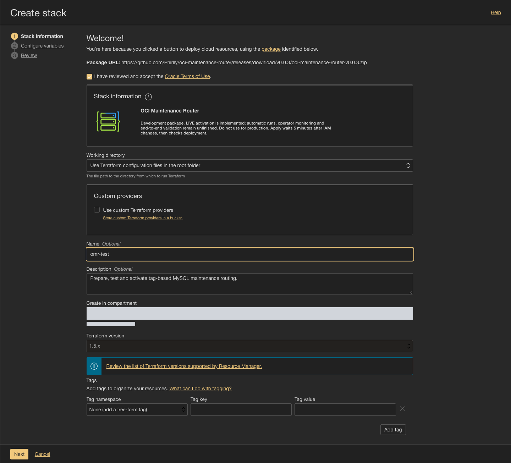
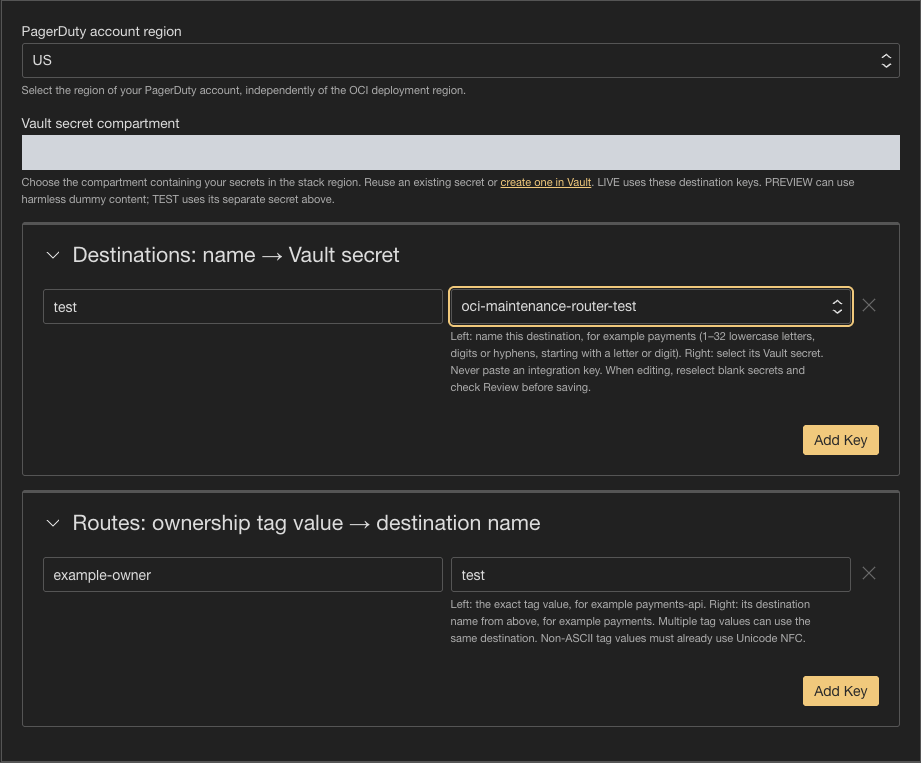
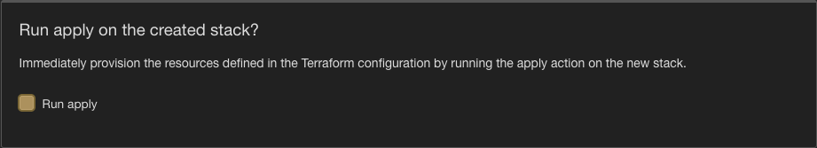

# Deploy OCI Maintenance Router v0.0.3

For OCI users deploying a nonproduction test. Maintained by the project contributors.

This walkthrough deploys the router through Resource Manager (RM) and sends a **test alert to PagerDuty**. No local build or Function command is needed. TEST does not process MySQL maintenance notices or enable LIVE routing. This is a development version, not a production release.

## Before you begin

- Choose an OCI region and an isolated compartment. Your account must be allowed to create the stack's resources, including tenancy-level IAM policies and a dynamic group.
- Have an active, nonproduction [PagerDuty service with an Events API V2 integration](https://docs.pagerduty.com/incident-management/services/services-and-integrations). Check its recipients so the test cannot page production responders.
- [Store that integration key in an OCI Vault secret](https://docs.oracle.com/en-us/iaas/Content/secret-management/Tasks/create-secret.htm) in the **stack region**. Use manual secret generation with plaintext content and an existing vault/symmetric key. RM selects the secret reference; never paste the integration key into the stack form.

Screenshots 1–5 show an unsaved configuration example. The successful Apply and received alert are from a separately verified fresh deployment of the **same v0.0.3 package bytes**, using an existing network. Private identifiers and confirmation codes are masked. Click an image to enlarge it.

## 1. Open the deployment

Click **Deploy to Oracle Cloud** in the [project README](../README.md). Sign in to your tenancy and select the intended region.

Confirm that the package URL ends in `v0.0.3/oci-maintenance-router-v0.0.3.zip`. Review Oracle's terms, choose a stack name and compartment, and keep **Terraform 1.5.x**, the root working directory and custom providers disabled. Select **Next**. The optional stack tags on this page are separate from database ownership tags.

## 2. Set up the test

Under **Placement**, enter a unique environment name, such as `omr-test`, and select the router compartment. Under **Operation**, select **TEST**.

| PagerDuty test field | What to enter |
| --- | --- |
| Test secret compartment | Compartment containing your test secret |
| Nonproduction PagerDuty secret | The secret containing the test service's Events API V2 key |
| This service may receive a nonproduction test alert | Select after checking the service's recipients |
| Test run number | `1` for this new installation |
| PagerDuty confirmation code | Leave empty for the first send |

Leave **Operator email**, its test number/code, **Saved-work closure** and **Sending recovery** empty or unchecked. These are not needed for this first PagerDuty test. Fields marked “Optional” can still be required by the selected mode; use the table above for TEST.

## 3. Configure scope and routing

These fields are required even in TEST. A maintenance notice is not needed for this walkthrough.

| Section | What to select |
| --- | --- |
| MySQL scope | Intended regions and compartments. Add child compartments separately; selecting the root does not include every child. |
| Ownership tag | Choose defined or freeform. For example: defined tag, namespace `Oracle-Tags`, key `CreatedBy`. Freeform tags have no namespace. |
| PagerDuty account region | `US` or `EU`, matching PagerDuty rather than the OCI region |
| Vault secret compartment | The compartment containing your destination secret |
| Destinations | Left: a name such as `test`. Right: select the same nonproduction secret for this isolated walkthrough. |
| Routes | Left: an ownership tag value. Right: the destination name `test`. |

The screenshot uses the illustrative value `example-owner` → `test`. For real maintenance routing, use the **exact, case-sensitive value already on the database**. TEST sends to the separate test secret from step 2; it does not exercise this tag match. No database or tag is created or modified.

## 4. Choose the network

- **New network:** leave **Create a new network** selected. Keep the default CIDR unless your network policy requires another range; the stack creates a private VCN, subnet and outbound gateways.
- **Existing network:** clear that checkbox, then choose the network compartment, VCN and **private regional subnet**. The subnet must already provide DNS and HTTPS access to the OCI services listed in the form and the selected PagerDuty endpoint. The stack does not change shared routes or security rules.

The verified deployment used this existing-network path:

## 5. Review, Plan and Apply

1. Select **Next** and check **Review**: TEST, run `1`, the intended secret, scope, route and network. If editing later and a saved compartment or secret appears blank, reselect every intended value and check the full list here.
2. Clear **Run apply**, then select **Create**. This creates the stack without provisioning yet.
3. On the stack page, select **Plan**. Leave **Upgrade provider versions** off. Wait for **Succeeded**, then inspect the proposed resources and IAM policies. Stop if the changes do not match your intended deployment.
4. Select **Apply**, choose that successful Plan under **Apply job plan resolution**, and leave provider upgrade off. Submit Apply once. [Oracle's Apply instructions](https://docs.oracle.com/en-us/iaas/Content/ResourceManager/Tasks/create-job-apply.htm) describe this flow.

**During Apply**, the stack waits five minutes after creating or changing its runtime IAM permissions, then checks access and sends the test. This wait is automatic. Our fresh test finished in about eight minutes overall; timing varies, and five minutes is not a guarantee that IAM is ready in every tenancy.

## 6. Verify the notification

In the successful Apply job's outputs, check:

| Output | Expected for the first TEST |
| --- | --- |
| `configured_mode` | `TEST` |
| `installation_status` | `operational-verified` |
| `test_submission_status` | `API_ACCEPTED` |
| `sending_enabled` | `false` — LIVE routing is not enabled |
| `test_receipt_confirmed` | `false` — no receipt code has been submitted yet |

Open your test service in PagerDuty and find **OCI maintenance router test notification**. Confirm the service and timestamp match your test. `API_ACCEPTED` alone is not proof that the alert appeared; the screenshot below shows the received alert from the verified deployment.

You have now demonstrated **RM deployment → Function test → PagerDuty receipt**. Leave the stack in TEST for this walkthrough. Real maintenance routing needs separate preparation and LIVE activation; it is not enabled by this test.

If Apply fails, read the job log and deployment-check error before retrying. Keep the same test settings and run number when retrying an unchanged test; a previously accepted request is reused. Do not increase the number just to bypass an error. An intentional new test after a package, service or PagerDuty-region change needs a new number and cleared confirmation codes.

The deployed resources remain in your tenancy and may incur charges. Private history storage is protected against normal Terraform destruction; removing the stack record alone is not a complete cleanup.
