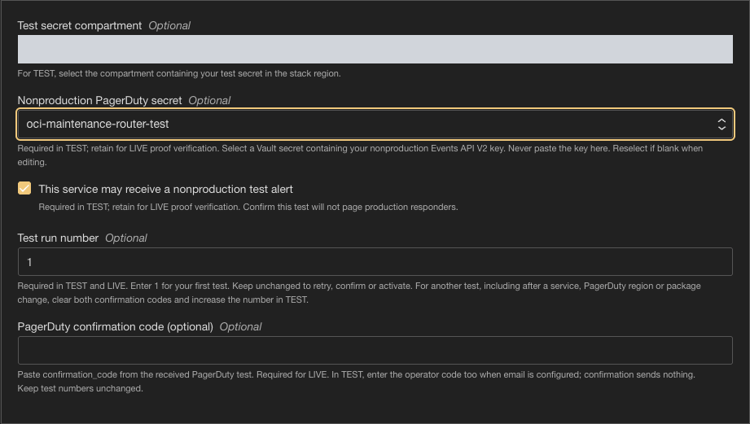
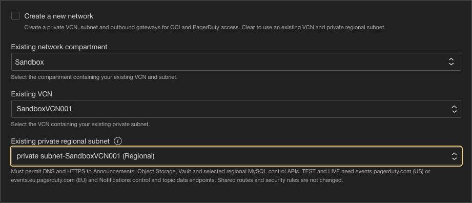
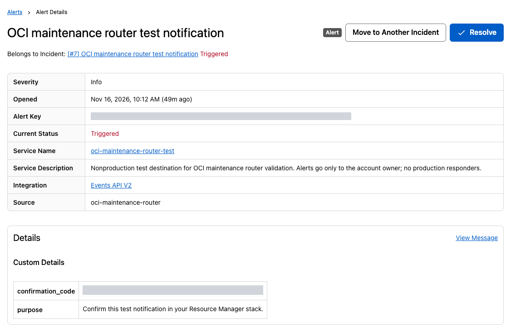

# Deploy OCI Maintenance Router v0.0.3

For OCI users deploying a nonproduction test. Maintained by the project contributors.

Deploy the router through Resource Manager (RM) and verify a **PagerDuty test alert**. No local build or Function command is needed. TEST does not route maintenance notices. This development version is not ready for production.

## Before you begin

- Choose an OCI region and an isolated compartment. Your account must be allowed to create the stack's resources, including tenancy-level IAM policies and a dynamic group.
- Have an active, nonproduction [PagerDuty service with an Events API V2 integration](https://docs.pagerduty.com/incident-management/services/services-and-integrations). Check its recipients so the test cannot page production responders.
- [Store that integration key in an OCI Vault secret](https://docs.oracle.com/en-us/iaas/Content/secret-management/Tasks/create-secret.htm) in the **stack region**. Use manual secret generation with plaintext content and an existing vault/symmetric key. RM selects the secret reference; never paste the integration key into the stack form.

Screenshots 1–5 show an unsaved configuration example. The Apply and PagerDuty screenshots show a successful fresh deployment of the **same v0.0.3 package**, using an existing network. Private values are masked. Click an image to enlarge it.

## 1. Open the deployment

Click **Deploy to Oracle Cloud** in the [project README](../README.md). Sign in to your tenancy and select the intended region.

Confirm that the package URL ends in `v0.0.3/oci-maintenance-router-v0.0.3.zip`. Review and accept Oracle's terms, then choose a stack name and compartment. Select **Terraform 1.5.x** and the **root working directory**. Leave **custom providers disabled**. Optional stack tags are separate from database ownership tags. Select **Next**.

## 2. Set up the test

Under **Placement**, enter a unique environment name, such as `omr-test`, and select the router compartment. Under **Operation**, select **TEST**.

| PagerDuty test field | What to enter |
| --- | --- |
| Test secret compartment | Compartment containing your test secret |
| Nonproduction PagerDuty secret | The secret containing the test service's Events API V2 key |
| This service may receive a nonproduction test alert | Select after checking the service's recipients |
| Test run number | `1` for this new installation |
| PagerDuty confirmation code | Leave empty for the first send |

Leave **Operator email**, its test number/code, **Saved-work closure** and **Sending recovery** empty or unchecked. Some form fields say “Optional” but are required in TEST; follow the table above.

## 3. Configure scope and routing

Complete these required settings. You do not need a maintenance notice for TEST.

| Section | What to select |
| --- | --- |
| MySQL scope | Regions and compartments to include. Select each child compartment separately. |
| Ownership tag | Choose defined or freeform. For example: defined tag, namespace `Oracle-Tags`, key `CreatedBy`. Freeform tags have no namespace. |
| PagerDuty account region | `US` or `EU`, matching PagerDuty rather than the OCI region |
| Vault secret compartment | The compartment containing your destination secret |
| Destinations | Left: `test`. Right: the same nonproduction secret selected in step 2. |
| Routes | Left: an ownership tag value. Right: the destination name `test`. |

The example maps `example-owner` → `test`. TEST uses the test secret from step 2 without checking this tag match. For maintenance routing, enter the **exact, case-sensitive tag value on the database**. No database or tag is modified.

## 4. Choose the network

- **New network:** leave **Create a new network** selected. Keep the default CIDR unless your network policy requires another range; the stack creates a private VCN, subnet and outbound gateways.
- **Existing network:** clear that checkbox, then choose the network compartment, VCN and **private regional subnet**. The subnet must already provide DNS and HTTPS access to the OCI services listed in the form and the selected PagerDuty endpoint. The stack does not change shared routes or security rules.

The verified deployment used an existing network:

## 5. Review, Plan and Apply

1. Select **Next** and check **Review**: TEST, run `1`, the intended secret, scope, route and network. If editing later and a saved compartment or secret appears blank, reselect every intended value and check the full list here.
2. Clear **Run apply**, then select **Create**. Resources are provisioned later, during Apply.
3. On the stack page, select **Plan**. Leave **Upgrade provider versions** off. Wait for **Succeeded**, then inspect the proposed resources and IAM policies. Stop if the changes do not match your intended deployment.
4. Select **Apply**, choose that successful Plan under **Apply job plan resolution**, and leave provider upgrade off. Submit Apply once. See [Oracle's Apply instructions](https://docs.oracle.com/en-us/iaas/Content/ResourceManager/Tasks/create-job-apply.htm).

**During Apply**, the stack automatically waits five minutes after changes to its runtime IAM permissions, then checks access before sending the test. Our fresh Apply took about eight minutes overall; permission changes and deployment can take longer.

## 6. Verify the notification

In the successful Apply job's outputs, check:

| Output | Expected for the first TEST |
| --- | --- |
| `configured_mode` | `TEST` |
| `installation_status` | `operational-verified` |
| `test_submission_status` | `API_ACCEPTED` |
| `sending_enabled` | `false` — LIVE routing is not enabled |
| `test_receipt_confirmed` | `false` — no receipt code has been submitted yet |

In PagerDuty, find **OCI maintenance router test notification** and confirm its service and timestamp. `API_ACCEPTED` confirms API acceptance; check the alert itself to verify receipt.

Leave the stack in **TEST** after this walkthrough.

If Apply fails, read the job log and deployment-check error. Keep the same settings and run number for an unchanged retry; do not increase the number to bypass an error. For a new test after a package, service or PagerDuty-region change, use a new number and clear the confirmation codes.

Resources remain deployed and may incur charges. Private history storage is protected against normal Terraform destruction; deleting the stack record alone does not clean up its resources.
